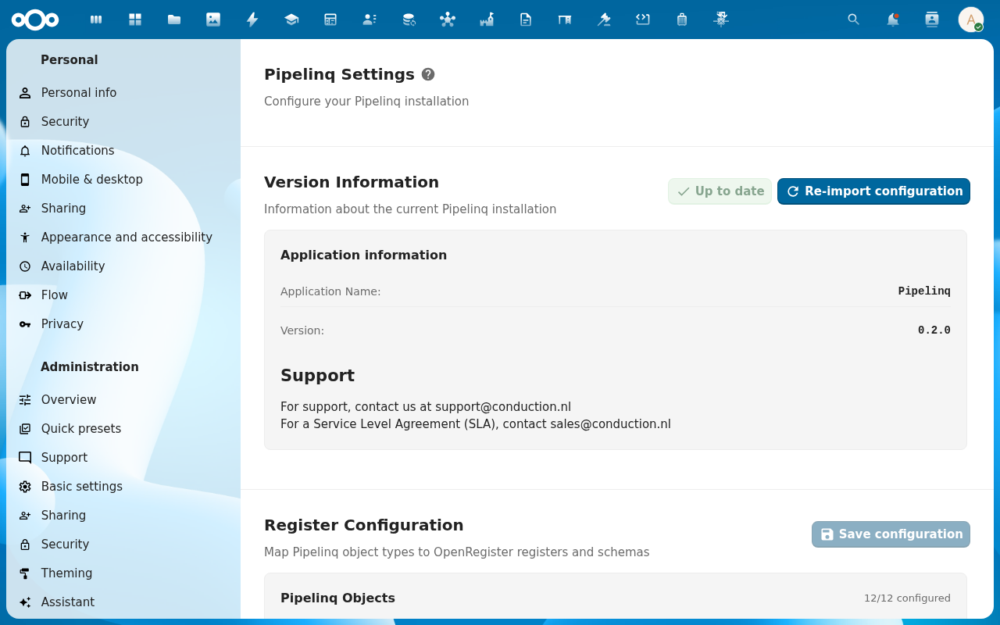

# Connect contacts and calendar sync

Pipelinq can keep its clients aligned with **Nextcloud Contacts** address books and surface callbacks in **Nextcloud Calendar**. As an admin you choose which address books and calendars are eligible and how conflicts are resolved; individual users then opt in per the [user sync tutorial](../user/07-sync-contacts.md).

## Goal

Enable contacts sync against one or more address books and turn on calendar sync for callbacks.

## Prerequisites

- You're a Nextcloud admin AND have Pipelinq's admin permission.
- The Nextcloud **Contacts** and **Calendar** apps are installed and enabled.

## Steps

### 1. Open Pipelinq admin settings

Settings menu → **Administration settings** → **Pipelinq**.


### 2. Scroll to **Pipelinq Settings** → *Sync integrations*

The integration toggles live on the **Pipelinq Settings** section at the top of the admin page (above the *Register Configuration* block). The two toggles you need are *Enable Contacts sync* and *Enable Calendar sync*.

### 3. Choose eligible address books

The address-book picker lists every address book on the Nextcloud instance. *System address books* (org-wide, available to all users) appear in the top group; *user address books* (per-account) in the bottom group. Sync is bidirectional by default: a contact created in Nextcloud Contacts appears in Pipelinq, and a client created in Pipelinq appears in the configured address book. Dedupe is by email-first then name-similarity; matching contacts are merged rather than duplicated. To opt out a book, leave it unchecked.



### 4. Enable calendar sync for callbacks

Pick the target calendar from the *Callback calendar* dropdown. You have two patterns. **Per-user**: each callback lands in the assignee's personal *Pipelinq callbacks* calendar (auto-created on first sync), which keeps personal calendars uncluttered for non-assignees. **Shared**: every callback lands in one org-wide calendar (pick an existing system calendar). The default is per-user; switch to shared when the org runs a centralised KCC where every agent sees every callback.


### 5. Meetings on leads, contacts and clients (calendar leaf)

The *Meetings* card on a lead, contact or client shows the events linked to that record through OpenRegister's calendar leaf, and the client's Activity timeline lists them too. Pipelinq reads these links live; it keeps no copy and writes to no calendar.

Events that were tagged on the Calendar side, or by an older version of the leaf, only reach the link table through OpenRegister's backfill. On an instance that already holds such events, enable it once and run it:

```bash
occ config:app:set openregister backfill_calendar_links --value=yes
occ background-job:execute 'OCA\OpenRegister\BackgroundJob\BackfillCalendarLinksJob'
```

What works today: links made through the leaf (the *Meetings* card's create and link actions) show up at once. Continuous two-way sync of events created or moved in Nextcloud Calendar arrives with OpenRegister's companion change `calendar-leaf-inbound`; until then a meeting moved in Calendar keeps its old time on the link until the backfill runs again.

Pipelinq reminds the assignee of a lead before a linked meeting, and the assignee of an open follow-up task before its deadline, as a Nextcloud notification. The look-ahead window is 24 hours by default:

```bash
occ config:app:set pipelinq followup_reminder_window_hours --value=48
```

### 6. Save

Users can now enable contacts sync from their own settings, and new callbacks appear in the configured calendar.

## Verification

- A user enables sync (see [Sync with Nextcloud Contacts](../user/07-sync-contacts.md)) and their clients map to the chosen address book.
- Creating a callback adds an event to the configured calendar.
- The duplicate-detection warning fires when a sync would create a clone. See [Resolve a duplicate](../user/08-resolve-duplicate.md).

## Common issues

| Symptom | Fix |
|---|---|
| No address books listed | The Contacts app isn't enabled, or the admin account has no access to any address book. |
| Callbacks don't appear in the calendar | The Calendar app isn't enabled, or the selected calendar is read-only for the assignee. |
| Older tagged events are missing from *Meetings* | Enable `backfill_calendar_links` in OpenRegister and run the backfill job (step 5). |

## Reference

- [Contacts sync feature reference](../../Features/contacts-sync.md)
- [Email & calendar sync feature reference](../../Features/email-calendar-sync.md)
